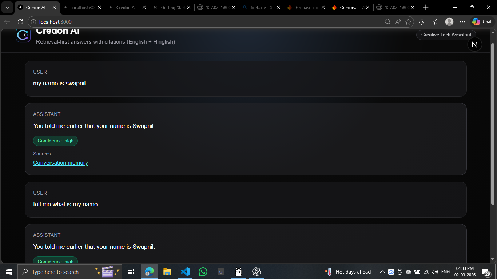

# Firebase Setup and Connection (Credon AI)

## 1) Create Firebase Project
1. Open Firebase Console.
2. Create a new project, e.g. `credon-ai`.
3. In Project Settings -> General, add a Web App.
4. Copy the Firebase web config values.

## 2) Enable Auth
1. Go to Authentication -> Sign-in method.
2. Enable Email/Password (and Google optionally).
3. Save.

## 3) Enable Firestore
1. Go to Firestore Database -> Create database.
2. Choose test mode for development.
3. Select nearest region.

## 4) Configure Frontend Env
1. In `frontend`, create `.env.local` from `frontend/.env.local.example`.
2. Fill all `NEXT_PUBLIC_FIREBASE_*` values.
3. Keep `NEXT_PUBLIC_API_BASE=http://127.0.0.1:8000`.

## 5) Configure Backend Env for Firebase Admin
Use your root `.env` (or environment variables) with:
- `FIREBASE_PROJECT_ID`
- `FIREBASE_CLIENT_EMAIL`
- `FIREBASE_PRIVATE_KEY`

Notes:
- `FIREBASE_PRIVATE_KEY` must preserve new lines as `\n` in env format.
- Backend already supports Firebase and will fall back to in-memory if env vars are not set.

## 6) Generate Service Account Credentials
1. Firebase Console -> Project Settings -> Service accounts.
2. Click Generate new private key.
3. From JSON file:
   - `project_id` -> `FIREBASE_PROJECT_ID`
   - `client_email` -> `FIREBASE_CLIENT_EMAIL`
   - `private_key` -> `FIREBASE_PRIVATE_KEY` (replace real line breaks with `\n`)

## 7) Run Locally
- Backend:
  - `C:/Users/Swapnil/credon-ai/.venv/Scripts/python.exe -m uvicorn app.main:app --host 127.0.0.1 --port 8000 --reload`
- Frontend:
  - `npm run dev` (inside `frontend`)


- Open `http://127.0.0.1:3000`
- Send a chat message.
- Verify sessions API:
  - `GET http://127.0.0.1:8000/api/v1/chats/student-user`

## 9) Recommended Firestore Security Rules (dev starter)
```txt
rules_version = '2';
service cloud.firestore {
  match /databases/{database}/documents {
    match /{document=**} {
      allow read, write: if request.auth != null;
    }
  }
}
```
For production, tighten this by user ID.

## 10) Genkit: How to Use It in This Project

Genkit is most useful for hosted LLM orchestration, prompt flows, safety, and evaluation.

### Best practical setup for your current app
- Keep your current Python FastAPI backend for retrieval and chat storage.
- Add a small Node Genkit service only for generation/reranking when needed.
- Python service calls Node Genkit endpoint when `USE_LOCAL_MODEL=false`.

### Why this is good for a student build
- No need to run Ollama for all users.
- You can start with free-tier usage and switch providers later.
- Prompt flows, tracing, and eval become easier than custom logic everywhere.

### Suggested phased rollout
1. Phase A: Current retrieval + memory (already working)
2. Phase B: Add Genkit endpoint for grounded answer synthesis
3. Phase C: Add eval set and quality scoring in Genkit
4. Phase D: Add moderation/safety checks and fallback policies

### Genkit features to prioritize first
- Prompt templates for English + Hinglish styles
- Structured JSON output (answer, confidence, citations)
- Retry/fallback policy when model call fails
- Basic evaluation dataset for response quality

### Important
- Do not migrate everything at once.
- Keep retrieval in Python now and only offload generation to Genkit first.
